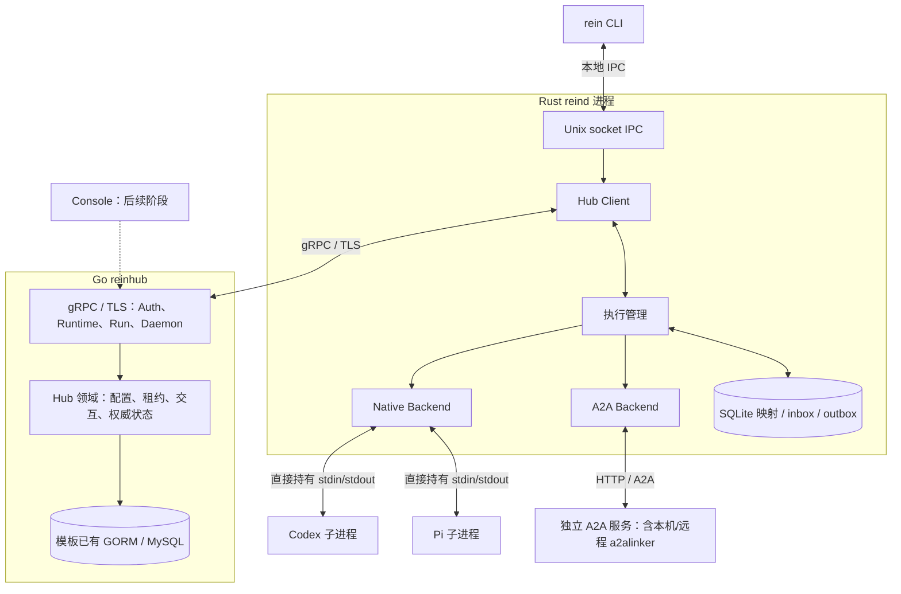

# 第一阶段架构骨架

共享 Rust 适配代码运行在 reind 进程内，不是图中的独立服务。Native 不调用 a2alinker Server/Gateway，不绑定 HTTP 端口。

## 框架已经表达的边界

| 仓库 | 框架入口 | 具体实现状态 |
| --- | --- | --- |
| proto | 四份 proto、生成 Rust/Go 接口、fixtures、CI | 契约可生成与检查，见 semantics.md |
| reinhub | 模板 app 组装可选 TLS gRPC；hub 领域、模型、Repository 边界 | Auth 返回 UNIMPLEMENTED；受保护 RPC/流默认拒绝 |
| rein | HubClient、ExecutionManager、Backend、IPC 与 CLI 命令 | Client 可建 TLS 通道；IPC 尚未启动后台 Hub 工作循环 |
| a2alinker | native 无 HTTP API，复用既有适配器 | 原有适配器不复制；reind 暂不调用实际执行 |

## 交互顺序

1. CLI `login` 发送 LoginStart IPC。未来后台 reind 调用 StartLogin/GetLoginStatus，保存凭据，向 CLI 只返回公开登录状态。
2. reind 注册 Runtime，主动打开 Connect 双向流，Hello → 对账 → 领取。
3. CLI 创建 Run 或控制现有 Run 都经 reind 转交 Hub，Hub 完成授权与持久化。
4. 工作通知只唤醒，实际容量通过 ClaimRuns 提交；启动、事件和结果都绑定 attempt。
5. ExecutionManager 选择 Native 或 A2A，基础事件共用，专属控制按能力验证。
6. 事件先写本地 outbox，Hub 事务提交后累计 ACK；取消须等待执行真正停止。

## 本轮明确未实现

- 真实登录授权、凭据安全存储/续期/撤销、资源权限检查。
- Hub 事务、队列、租约、命令投递、执行状态机；模型尚未注册迁移。
- reind 的后台任务循环、SQLite 读写与恢复、事件流重连对账。
- Native/A2A 的实际执行、审批、取消与专属控制接线。
- Console 接入、部署与完整端到端验收。

这些位置返回明确错误或使用 TODO，不能把骨架当成已完成的执行闭环。
