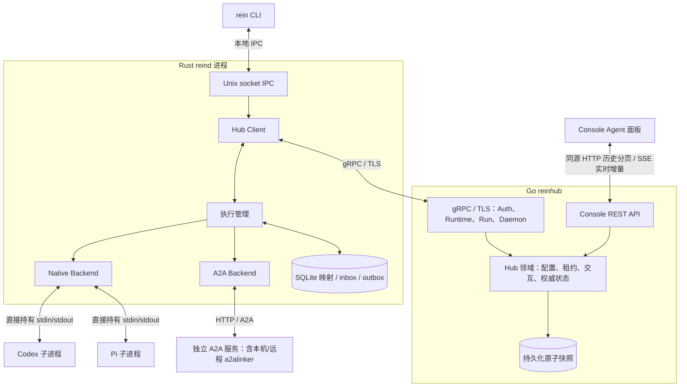

# 本机 Console / Hub 执行闭环

共享 Rust 适配代码运行在 reind 进程内，不是图中的独立服务。Native 不调用 a2alinker Server/Gateway，不绑定 HTTP 端口。

## 当前边界

| 仓库 | 实现状态 |
| --- | --- |
| proto | 版本化 gRPC，RuntimeService 包含 Agent 注册/列表；固定生成器、fixtures 和兼容检查 |
| reinhub | 当前单机实现：TLS、注册、队列、领取、去重事件与 ACK、交互、取消、对账、Console API；暂不接入登录，仅支持 loopback |
| rein | CLI 经 IPC 注册；后台 gRPC 流；Native/A2A 执行；SQLite 映射与 inbox/outbox |
| a2alinker | 无 HTTP 原生 Rust API；也可单独启动 A2A 服务 |
| rein-console | 默认请求 Hub Agent 列表；会话、执行记录、工具、审批、取消、刷新恢复；原演示显式 opt-in |

## 交互顺序

1. 使用 Hub 普通配置启动，生成 CA 与服务端证书；顶层 directory 默认 ~/.reinhub。当前暂不接入登录，不签发假凭据。
2. `rein register agent codex|pi|a2a` 经 IPC 交给 reind，保存本地配置、稳定 ID 和 Hub/CA 连接信息。
3. reind 注册 Runtime 与 Agent，主动打开 gRPC/TLS Connect 流；Hello / 对账完成后才领取。
4. Console 通过同源 HTTP 代理请求 Hub 列表、最近对话、历史分页，并创建 Run、提交控制；SSE 推送实时增量和控制回执。HTTP 历史快照返回提交游标，SSE 从该位置续接，客户端按 run/attempt/sequence 去重。HTTP DTO 嵌套消息使用 Protobuf JSON 表示。
5. 通知只提示可领取；daemon 按执行容量 ClaimRuns，保存领取检查点，先上报启动事件并等待持久化 ACK，再调用 Backend。
6. Native 直接持有 Codex/Pi 管道；A2A 使用独立服务。统一事件写入 SQLite outbox，Hub 落盘并更新状态后累计 ACK。
7. 审批绑定 run / attempt / interaction，控制 command_id 去重；取消意图与停止确认分离。
8. 重连对账后重传 outbox，不重新运行已领取执行。正常 daemon 重启恢复注册和已知会话映射；未知执行保留失败与阻塞信息，禁止自动重跑。

## 当前限制

登录/权限、事务数据库、人工恢复工具、用量采集和 steer 等高级控制尚未实现。本机 Hub 使用单进程文件锁与原子快照，不作为多实例服务；A2A 使用 v1 JSON-RPC 快照轮询，未接订阅或其他 transport。平台旧 CLI Run 操作仍为框架入口，当前经 Console 验证。

当前不区分开发/生产模式，待 daemon 功能完备后再重构 Hub。完整启动、测试和数据位置见相邻 rein 仓库的 `docs/console-integration.md`。
